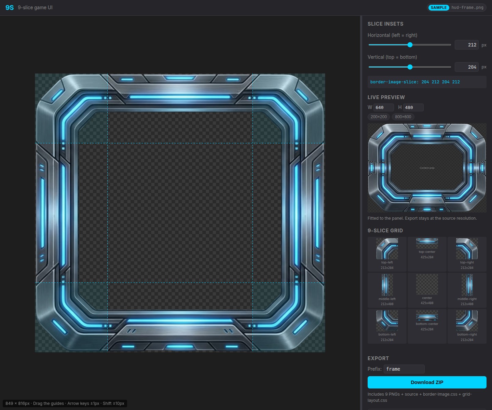
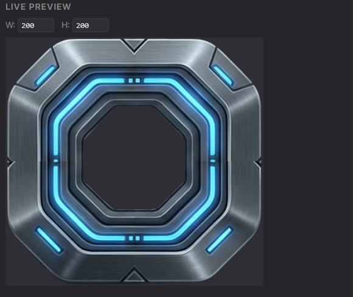

# 9S

## Project Summary

9S is a browser-based 9-slice authoring tool for turning a single frame image into reusable interface assets. It lets you define slice boundaries visually, preview scaling behavior, and export both image slices and CSS implementations for production use.

## Live demo

The published build opens on a sample HUD frame. Drag the guides, resize the preview, or drop your own PNG. Nothing is uploaded to a server.

**[Open the live demo](https://newjordan.github.io/9S/)**



`npm run build` writes a static site to `dist/`. Asset URLs are relative, so the same folder works at a domain root or under a project path.

- **GitHub Pages:** [`.github/workflows/pages.yml`](.github/workflows/pages.yml) publishes `dist/` on every push to `main`. One-time setup: Settings → Pages → Build and deployment → Source: **GitHub Actions**.
- **Vercel:** import the repo. [`vercel.json`](vercel.json) builds with Vite and serves `dist/`.

## Why This Exists

Interface frames often start as bespoke artwork and end up needing to behave like a flexible system. That handoff is usually slow and error-prone.

9S explores a faster bridge between visual asset creation and interface implementation. The core idea is simple: make the slicing, previewing, and export workflow direct, visual, and immediate.

## Key Ideas or Features

- Drag slice handles directly on the canvas.
- Preview how frames scale at different dimensions before export.
- Export both `border-image` and CSS Grid approaches.
- Package the full result as a ZIP with source art plus generated slices.
- Support drag-and-drop uploads and keyboard fine-tuning.
- Keep the entire workflow browser-based with no backend dependency.

## How It Works (High Level)

1. Load a PNG frame into the editor. The demo starts from a bundled sample.
2. Adjust horizontal and vertical insets to define the nine regions.
3. Preview the frame at different sizes to validate edge and corner behavior.
4. Generate CSS plus sliced PNG assets from the same source.
5. Download the packaged output for use in game, app, or web interfaces.

## Demo / Screenshots

The same kind of frame, previewed small and wide. Corners stay intact while the edges stretch.

| 200 × 200 | 800 × 600 |
|:---:|:---:|
|  |  |


## Getting Started

### Requirements

- Node.js 20.19+ or 22.12+
- npm

### Run Locally

```bash
git clone https://github.com/newjordan/9S.git
cd 9S
npm install
npm run dev
```

Open `http://localhost:5173`.

`npm run build` typechecks and writes the static site to `dist/`. `npm run preview` serves that build. `npm run lint` runs ESLint.

## Future Experiments

- Add preset export targets for game UI frameworks and design systems.
- Support batch slicing for frame libraries.
- Expand output formats for additional layout engines.
- Explore prompt-assisted generation of decorative frame variations.
