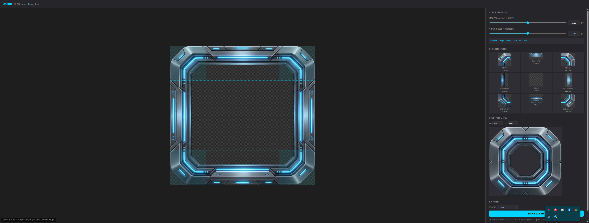
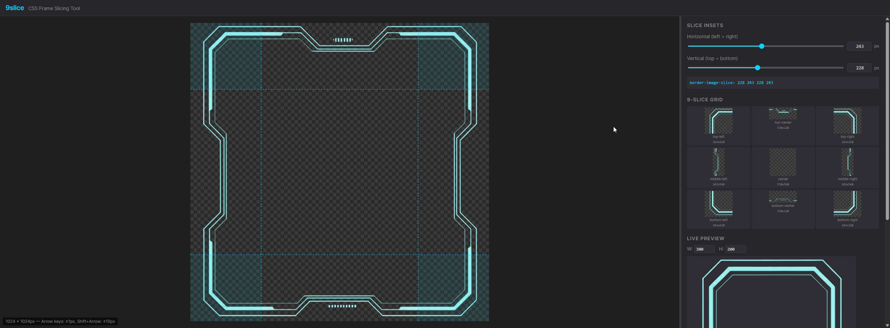
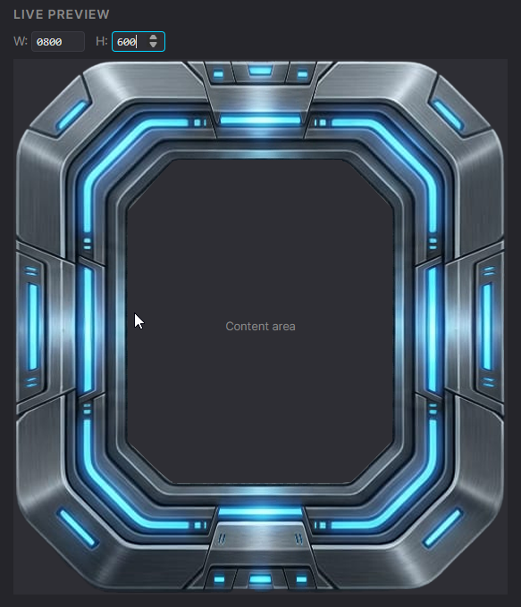
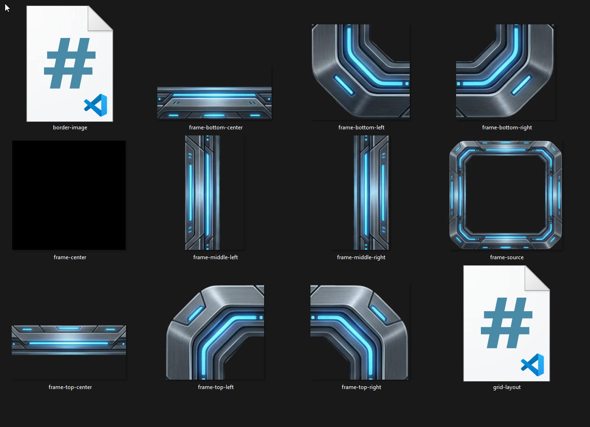

# 9Slice — CSS Frame Slicing Tool

A browser-based tool for slicing images into 9-slice grids, generating ready-to-use CSS and PNG assets. Perfect for creating scalable UI frames, borders, and panels for games, apps, and websites.



## What is 9-Slice Scaling?

9-slice (or 9-patch) scaling is a technique that divides an image into 9 regions — four corners, four edges, and a center — allowing the image to be resized to any dimension without distorting the corners. This is widely used for UI frames, dialog boxes, buttons, and panels in game development and web design.

## Features

- **Interactive Visual Editor** — Drag handles directly on the canvas to define slice boundaries
- **Real-Time 9-Slice Grid** — See all 9 regions update live as you adjust insets
- **Live Preview** — Preview how the frame looks at any custom width and height
- **Dual CSS Export** — Generates both `border-image` and CSS Grid approaches
- **One-Click ZIP Download** — Exports 9 PNG slices + source image + both CSS files
- **Keyboard Controls** — Arrow keys for fine-tuning (1px), Shift+Arrow for larger steps (10px)
- **Drag & Drop Upload** — Drop any PNG onto the editor to get started
- **Resizable Sidebar** — Adjust workspace layout by dragging the divider
- **Dark Theme** — Easy on the eyes for extended editing sessions

## Screenshots

### Editor Workspace

The main workspace with interactive slice handles and real-time controls:



### Live Preview

Preview how your frame scales at different dimensions:

| 200 x 200 | 800 x 600 |
|:---:|:---:|
|  |  |

### Export Output

One-click export generates a ZIP containing all 9 slices, the source image, and two CSS files:



## Getting Started

### Prerequisites

- [Node.js](https://nodejs.org/) 18+
- npm

### Install & Run

```bash
git clone https://github.com/newjordan/9slice-tool.git
cd 9slice-tool
npm install
npm run dev
```

Open [http://localhost:5173](http://localhost:5173) in your browser.

### Build for Production

```bash
npm run build
npm run preview
```

The optimized output will be in the `dist/` directory — deploy it to any static host.

## Usage

1. **Upload** — Drag and drop a PNG image onto the editor, or click to browse
2. **Adjust Slices** — Drag the handles on the canvas, use the sliders, or type exact pixel values
3. **Preview** — Check the 9-slice grid and live preview in the sidebar
4. **Export** — Set a filename prefix and click **Download ZIP**

### Exported Files

The ZIP contains:

| File | Description |
|------|-------------|
| `{prefix}-source.png` | Original image |
| `{prefix}-top-left.png` | Top-left corner |
| `{prefix}-top-center.png` | Top edge |
| `{prefix}-top-right.png` | Top-right corner |
| `{prefix}-middle-left.png` | Left edge |
| `{prefix}-center.png` | Center region |
| `{prefix}-middle-right.png` | Right edge |
| `{prefix}-bottom-left.png` | Bottom-left corner |
| `{prefix}-bottom-center.png` | Bottom edge |
| `{prefix}-bottom-right.png` | Bottom-right corner |
| `border-image.css` | CSS using `border-image` property |
| `grid-layout.css` | CSS using CSS Grid layout |

### Using the Generated CSS

**Option 1 — `border-image` (simplest)**

```css
.my-frame {
  border-style: solid;
  border-width: 204px 212px;
  border-image-source: url('frame-source.png');
  border-image-slice: 204 212 204 212 fill;
  border-image-repeat: stretch;
  box-sizing: border-box;
}
```

**Option 2 — CSS Grid (more control)**

```html
<div class="frame-grid">
  <div class="frame-tl"></div>
  <div class="frame-tc"></div>
  <div class="frame-tr"></div>
  <div class="frame-ml"></div>
  <div class="frame-c">Your content here</div>
  <div class="frame-mr"></div>
  <div class="frame-bl"></div>
  <div class="frame-bc"></div>
  <div class="frame-br"></div>
</div>
```

## Tech Stack

- **React 19** + **TypeScript**
- **Vite 7** — Build tooling and dev server
- **JSZip** — ZIP file generation
- **FileSaver.js** — Client-side file downloads
- Zero backend — everything runs in the browser

## Project Structure

```
src/
├── components/
│   ├── Layout.tsx          # Resizable two-pane layout
│   ├── SliceCanvas.tsx     # Interactive canvas with drag handles
│   ├── SliceControls.tsx   # Inset sliders and numeric inputs
│   ├── SlicePreview.tsx    # 9-slice grid + live preview
│   ├── ImageUploader.tsx   # Drag-and-drop upload screen
│   └── ExportButton.tsx    # ZIP export with prefix input
├── hooks/
│   ├── useImageLoader.ts   # Image loading and error handling
│   ├── useSliceState.ts    # Inset state management
│   └── useCanvasRenderer.ts # Canvas rendering with DPR scaling
├── utils/
│   ├── canvasHelpers.ts    # Checkerboard, slice lines, overlays
│   ├── sliceImage.ts       # 9-region extraction to PNG blobs
│   ├── generateCSS.ts      # CSS code generation
│   └── exportZip.ts        # ZIP packaging
├── types/
│   └── index.ts            # TypeScript type definitions
├── constants.ts            # Colors and sizing constants
├── App.tsx                 # Root component
├── main.tsx                # Entry point
└── index.css               # Global styles
```

## License

[MIT](LICENSE)
